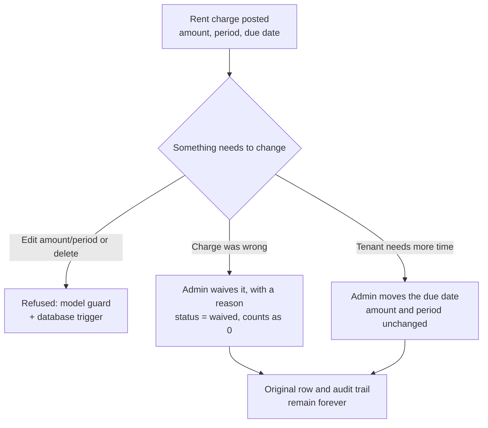
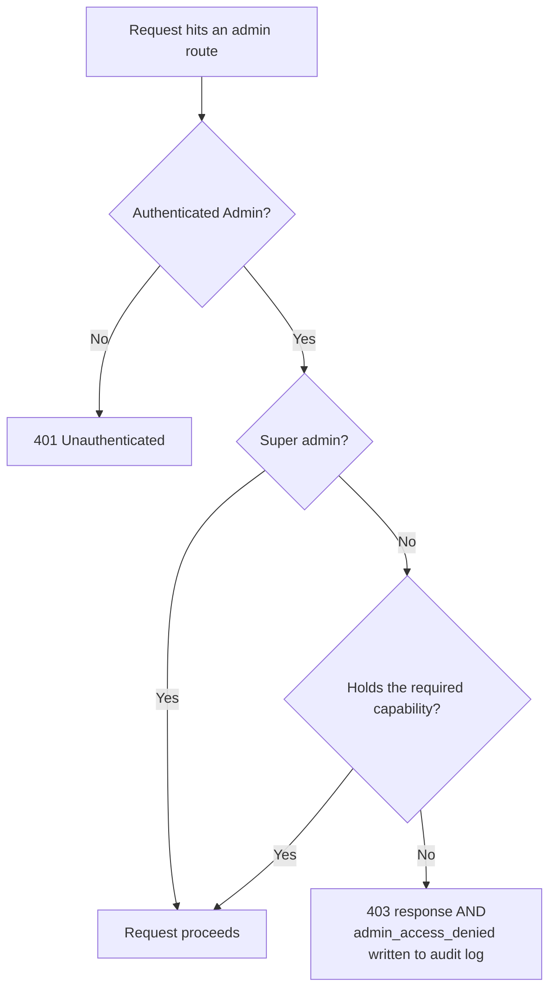
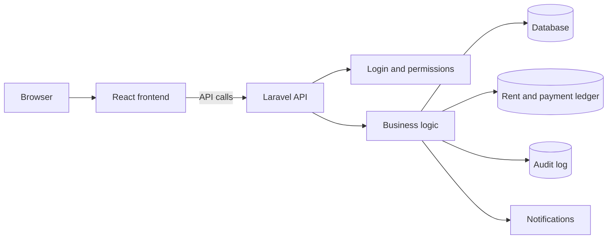

# Wyncrest

Wyncrest is a rental operations system built around one guarantee: every rent charge, payment, and privileged action is written to a permanent record that cannot be quietly edited later.

It is not a property-management dashboard with a ledger bolted on. The ledger and the audit log are the foundation everything else (listings, contracts, notifications) is built on top of.

| Area | Status |
|---|---|
| Backend | Laravel 12, tests run via `php artisan test` (see verification block below) |
| Frontend | React 18 + TypeScript, builds clean, lint clean, no automated test suite (see Known limitations) |
| Database | SQLite (the verified launch engine, single host). PostgreSQL installs and seeds but is not yet verified end to end; MySQL is untested |
| Authentication | Token-based login, separate tenant/landlord and admin accounts |
| Live demo | <http://18.216.245.190> (HTTP only, no TLS. A single-instance showcase, not a production environment.) |
| Current state | Actively developed. Runs locally via a one-command setup. |

Maintainer: **Elton Sakyi**

---

## What Wyncrest does

Wyncrest manages a rental from the first listing to the last rent payment, in one place.

- **Tenants** find homes, apply, sign leases, pay rent, and message their landlord.
- **Landlords** list properties, review applicants, send contracts, and track rent collection.
- **Admins** moderate listings, verify identities, and keep the platform healthy.
- **Super admins** decide which admins can do what.

Every rent charge, payment, and privileged action is written to a permanent record that cannot be quietly edited later. That record is what makes the platform trustworthy: a landlord, a tenant, or an auditor can always see exactly what happened and when.

## The problem this solves

A rent dispute is usually an argument about what happened: did the tenant pay on time, did the landlord apply a late fee they weren't entitled to, did an admin waive a charge and for whom. Most systems store a single "balance" number that anyone with database access can edit, which means the dispute has no independent evidence to settle it.

Wyncrest never stores a balance as an editable number. A balance is always the sum of an append-only list of entries, and every privileged action that touches the platform is written to a hash-chained audit log. The history is the evidence.

## How the ledger stays honest

A ledger entry's posted terms (amount, type, parties, billing period and posted due date) never change, and entries are never deleted. This is enforced in three places: the `LedgerEntry` model refuses `update()`, `save()` and `delete()`; status changes go only through a compare-and-swap (`transitionStatus()`); and on SQLite and PostgreSQL, database triggers refuse any `DELETE` of a ledger row and any `UPDATE` of a posted term, and refuse to delete a contract or user that still has ledger history (migration `2026_11_18_000003`).

The only correction is a **waiver**: an admin moves an unpaid charge to the terminal `waived` state with a reason, which is kept in the audit log, and the charge then counts as zero. Wyncrest has no reversing or compensating entries, partial payments or refunds. An admin may also move an unpaid rent charge's **due date** (never its amount or period); the posted date is kept in `original_due_date` and every move is recorded in `ledger_due_date_revisions`.

All derived numbers (collected, outstanding, overdue, running balance) are computed in one place, `app/Services/Ledger/LedgerComputationEngine.php`, so the admin, landlord, and tenant views can never quietly disagree about what a tenant owes. Full detail: [`docs/LEDGER.md`](docs/LEDGER.md).

Privileged actions get the same treatment a different way: every row in `audit_logs` is SHA-256 hash-chained to the row before it, anchored at a `GENESIS_HASH` for the first row. Editing any historical row breaks every hash after it, which `AuditLogService::verifyChain()` detects by recomputing the chain. A backfill migration re-canonicalised existing rows so the chain covers data older than the hash column itself.

## Roles and authorization

| Role | What they can do |
|---|---|
| **Tenant** | Browse listings, apply, manage their own lease, pay rent, message their landlord, request maintenance |
| **Landlord** | List properties, review applicants, send contracts, track their own ledger and tenants |
| **Admin** | Moderate listings and reviews, verify identities, manage user accounts, view the audit log |
| **Super admin** | Everything an admin can do, plus deciding which capabilities other admins are granted |

Admin access is broken into 12 named capabilities (`app/Enums/AdminCapability.php`), enforced server-side by the `EnsureAdminCan` middleware on every admin route. A denied check is not a silent 403: the middleware writes its own `admin_access_denied` audit event, so an admin repeatedly reaching outside their grant leaves a trail. One capability, `MANAGE_SETTINGS`, is flagged in the enum as defined but not yet enforced by any route (`AdminCapability::isEnforced()`), rather than pretending it gates something it doesn't.

Full detail on what each role and capability can and cannot do: [`docs/AUTHORIZATION.md`](docs/AUTHORIZATION.md).

## What went wrong, and how it was caught

A full-codebase readiness audit in July 2026 swept all API routes, all frontend pages, and every notification and audit-log write site before treating the platform as ready for real use. It found and fixed, among other things:

- **A payment double-charge bug.** A successful Stripe payment recorded the payment but left the original rent charge pending, so a paid charge could be marked overdue, hit with a late fee, and charged again. Fixed in `PaymentService::recordSuccessfulPayment`, now a locked transaction that verifies the exact amount and currency before marking the obligation paid.
- **An IDOR in landlord analytics.** A landlord could pass another landlord's `property_id` into the analytics endpoints and read their revenue and contract data. Now ownership-checked and rejected with a 403.
- **A cross-tenant analytics cache leak.** The cache key didn't include the requesting landlord's identity, so two landlords calling the endpoint with no filters could share one cache slot and see each other's numbers. The key now always includes the user.

Finding your own IDOR and cache leak before anyone else does is the outcome an audit like this is supposed to produce. Full findings, including the security and data-integrity issues: [`WYNCREST_PRODUCTION_READINESS_REPORT.md`](WYNCREST_PRODUCTION_READINESS_REPORT.md).

## Test verification

Run on 3 September 2026 against `main` at `ca667c21`.

| Check | Command | Result |
|---|---|---|
| Backend suite | `php artisan test` | **1,101 passed**, 4,507 assertions, 0 failed, 27.44s |
| Frontend build | `npm run build` (frontend/) | Passed in 3.50s |
| Lint | `npm run lint` (frontend/) | Passed, 0 errors, 2 react-refresh warnings |
| CI | `.github/workflows/ci.yml` | Passing on `main` |

The backend figure is the test runner's own output, not a count of methods in the source.
There is no automated frontend test suite; see Known limitations.

## Features

| Group | What it covers |
|---|---|
| Accounts and access | Registration, login, roles, granular admin permissions |
| Properties and listings | Property and unit catalogues, public listings, admin moderation |
| Contracts | Lease drafting, sending, acceptance, and termination |
| Ledger and payments | Rent charges, late fees, Stripe-backed payments, balance tracking |
| Notifications | In-app, email, and SMS alerts for the events that matter |
| Audit logs | A permanent, hash-verified record of every privileged action |
| Admin controls | User moderation, feature gating, platform analytics |
| UI and themes | Light and dark mode, a selectable accent color, a shared design system |

## How it fits together

The frontend never decides what a user is allowed to do. It only asks the backend, and the backend enforces every rule. A typical rental runs listing to approval, application, contract, ledger-driven rent charges, Stripe payment, and a notification plus an audit record on every payment. Full detail: [`docs/ARCHITECTURE.md`](docs/ARCHITECTURE.md).

## Tech stack

| Layer | Technology |
|---|---|
| Frontend | React 18, TypeScript, Vite, Tailwind CSS |
| Backend | Laravel 12, PHP 8.2+ |
| Database | SQLite (verified); PostgreSQL partially verified; MySQL untested |
| Authentication | Laravel Sanctum (token-based) |
| Payments | Stripe |
| Messaging | Twilio (SMS) |
| Testing | PHPUnit (backend), ESLint and TypeScript checks (frontend) |

## Getting started

Wyncrest has a one-command local runner that resets the database, seeds realistic demo data, and starts everything at once. Full setup steps, prerequisites, and troubleshooting live in [`docs/DEVELOPMENT.md`](docs/DEVELOPMENT.md).

## Development mode vs. production mode

| | Development mode | Production mode |
|---|---|---|
| Purpose | A realistic local demo world for building and testing | A clean, real platform with no invented data |
| Demo accounts | Yes, several landlords and tenants | Never |
| Fake rent, contracts, or payments | Yes, for testing | Never |
| Safe to reset | Yes, any time | No, production data is never wiped |

Full detail, including how demo accounts are structured: [`docs/SEEDING.md`](docs/SEEDING.md).

## Security, in short

- Every protected action is checked on the backend, not just hidden in the interface.
- Admin access is granular: a super admin decides exactly what each admin can do.
- Rent and payment history cannot be edited after the fact, only corrected with a new, visible entry.
- Every privileged action is written to a permanent audit log.

Full security policy: [`SECURITY.md`](SECURITY.md). Full access-control model: [`docs/AUTHORIZATION.md`](docs/AUTHORIZATION.md).

## Contributing

Bug, feature, and documentation issues use structured templates, and every pull request runs the same checks a contributor would run locally: backend tests, frontend lint, and frontend build. See [`CONTRIBUTING.md`](CONTRIBUTING.md) for the full ground rules.

## Documentation map

| Doc | What it covers |
|---|---|
| [`SECURITY.md`](SECURITY.md) | Security policy, how to report an issue, production safety rules |
| [`CONTRIBUTING.md`](CONTRIBUTING.md) | How to contribute, git rules, and commit standards |
| [`WYNCREST_PRODUCTION_READINESS_REPORT.md`](WYNCREST_PRODUCTION_READINESS_REPORT.md) | The full readiness audit: every defect found and fixed before treating the platform as ready |
| [`docs/README.md`](docs/README.md) | Index of every doc in the `docs/` folder |
| [`docs/ARCHITECTURE.md`](docs/ARCHITECTURE.md) | How the system is put together, and why |
| [`docs/AUTHORIZATION.md`](docs/AUTHORIZATION.md) | Roles, admin capabilities, and how access is enforced |
| [`docs/DATABASE.md`](docs/DATABASE.md) | The main data areas and how they relate |
| [`docs/DEVELOPMENT.md`](docs/DEVELOPMENT.md) | Local setup, running the app, common problems |
| [`docs/DEPLOYMENT.md`](docs/DEPLOYMENT.md) | Deployment checklist and what a real deployment still needs |
| [`docs/SEEDING.md`](docs/SEEDING.md) | Demo data, production seeding, and the two seeding modes |
| [`docs/TESTING.md`](docs/TESTING.md) | What is tested, and how to verify before pushing |
| [`docs/LEDGER.md`](docs/LEDGER.md) | How rent, payments, and balances work |
| [`docs/UI_SYSTEM.md`](docs/UI_SYSTEM.md) | The visual design system, themes, and accessibility rules |
| [`docs/API_REFERENCE.md`](docs/API_REFERENCE.md) | What each part of the API does, in plain language |
| [`docs/TROUBLESHOOTING.md`](docs/TROUBLESHOOTING.md) | Common problems and how to fix them |
| [`docs/GLOSSARY.md`](docs/GLOSSARY.md) | Plain-English definitions of every term used across these docs |
| [`docs/OPERATIONS.md`](docs/OPERATIONS.md) | Production safety checks and demo readiness |

## Known limitations

- No license has been chosen yet.
- The frontend has no automated test suite; UI changes are verified by lint, build, and manual browser review. See [`docs/TESTING.md`](docs/TESTING.md).
- A small set of internal identifiers (storage keys, cache key prefixes, one component name) still use the product's original working name, "Nexus," because renaming them would risk breaking existing local data. They are never shown to users. See [`docs/GLOSSARY.md`](docs/GLOSSARY.md) for the full list.

## License

License pending. No license has been chosen yet; all rights reserved until one is added.
