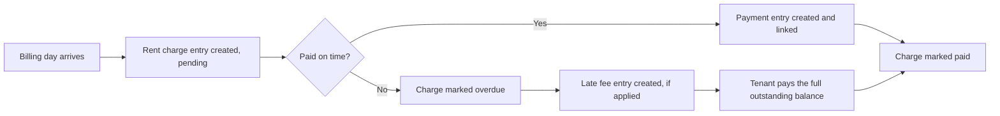

# The Ledger

How Wyncrest tracks rent, payments, and balances, explained simply enough for a non-technical admin to follow.

Who this is for: anyone who wants to understand how money is tracked in Wyncrest, technical or not.

## What the ledger is

The ledger is a permanent, growing list of money events for every lease: every rent charge, every payment, every late fee, every refund. Think of it like a bank statement that can never be edited, only added to.

A tenant's current balance is never stored as a single number that could be quietly changed. It is always calculated by adding up every entry in their ledger. If you want to know whether a tenant owes money, you read the history, not a separate "balance" field that someone could tamper with.

## Why it matters

This design means nobody, not a bug, not a mistake, not a bad actor, can make a tenant's balance disappear or appear out of nowhere. Every dollar (or cedi) is traceable to a specific, timestamped entry. That is what makes the financial history trustworthy enough for a landlord, a tenant, or a dispute to rely on.

## Rent charges

On the tenant's billing day each month, a new rent charge entry is created automatically. It starts as pending.

## Payments

When a tenant pays, a payment entry is created and linked to the charge it settles. Wyncrest only marks a charge as paid after the payment processor (Stripe) confirms the payment actually happened. It never trusts a "payment succeeded" message from the browser alone.

## Rent due dates

Owner policy (November 2026): **monthly rent is due on the 1st of each calendar month.**

- **Calendar months.** Every lease created after the policy bills 1st → last day of each month. A lease that starts mid-month first pays a **prorated** opening charge for the rest of that month (rent × days ÷ days in the month, rounded to the pesewa), due on the start date; a lease that ends mid-month pays a prorated closing charge. Example: GH₵2,500 a month starting 10 January → GH₵1,774.19 for 10–31 January due 10 January, then GH₵2,500 due 1 February.
- **Existing leases.** On upgrade, leases that had already been sent or signed and do not start on the 1st keep their signed anniversary periods (for example 10 January – 9 February), billed in full, so no period is skipped or charged twice. Their due date is the signed payment day, now always inside the period. Leases starting on the 1st, and drafts, move to calendar months. Moving an anniversary lease to calendar months is not automated; it needs an explicit owner decision about the stub.
- **One-time move.** An admin with *Manage ledger* can move one unpaid rent charge's due date (from today up to 60 days after its period ends). The amount, period and invoice reference never change; an overdue charge moved to a future date becomes pending again; an existing late fee is left as its own record. Paid and waived charges cannot be changed.
- **Future schedule.** An admin can set "from billing month X, rent is due on day N" (days 29–31 use the last day of shorter months) or return the lease to the 1st. Charges already issued keep their dates.
- **Time zone and grace.** All billing dates use one calendar, `BILLING_TIMEZONE` (default Africa/Accra). A charge becomes overdue the day after its due date (`BILLING_GRACE_DAYS`, default 0).
- **Missed months.** Each daily rent run bills every unbilled period from a lease's last charge up to today (at most 12), so a scheduler outage is recovered. Interior gaps are reported by `ledger:reconcile` (`rent_period_gap`) and closed with `php artisan ledger:backfill-rent {contract} --apply --reason="..."`.

Every change is audited and the tenant and landlord are notified.

## Late fees

If a rent charge is not paid by its due date, it moves to overdue. A late fee can then be applied, which creates its own separate entry rather than changing the original charge.

## Overdue balances

A tenant's outstanding balance is the sum of every unpaid or overdue entry on their ledger. Because this is calculated fresh from the real entries every time, it can never drift out of sync with reality.

## Why balances are derived, not stored

If a balance were stored as its own number, two things could go wrong: it could fall out of sync with the actual entries, or someone could edit it directly without leaving a trace. By always calculating the balance from the entries themselves, both problems disappear. The entries are the only truth.

## Why entries are never edited directly

A ledger entry, once written, stays exactly as it was written. If a charge was wrong, or a payment needs reversing, Wyncrest adds a new, visible correcting entry rather than silently changing the old one. This means the ledger always shows the full, honest history, including mistakes and their corrections, instead of a cleaned-up version that hides what actually happened.

## How this protects trust

- A tenant can always see exactly why they owe what they owe.
- A landlord can always see exactly what was charged and what was paid.
- An admin investigating a dispute can see the real order of events, not a summary that could have been edited after the fact.
- Nobody, including an admin, can make a balance vanish without leaving a visible entry behind.

## A rent cycle, start to finish

